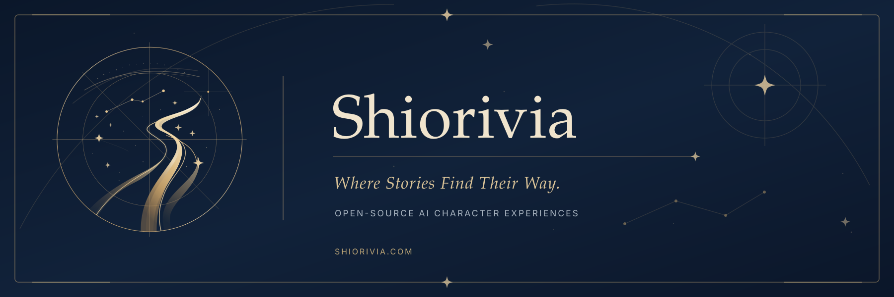

# Shiorivia · Local Edition

**Where Stories Find Their Way.**

A local-first, customizable space for AI conversations, characters, and interactive stories.

**[简体中文](#简体中文) · [繁體中文](#繁體中文) · [English](#english) · [日本語](#日本語) · [한국어](#한국어)**

[Cloud Edition](https://github.com/seemoon1/Shiorivia_Cloud) · [Development](docs/development.md) · [Security](SECURITY.md) · [Branding](BRANDING.md)

---

## 简体中文

Shiorivia 是一个**本地优先的沉浸式 AI 交互与创作前端**。它把普通对话、角色扮演、多角色叙事与小说创作放在同一套界面中，同时让用户自行决定模型、角色设定与本地素材。

### 探索不同空间

| 空间 | 用途 |
| --- | --- |
| **Officina** | 工程、编程与日常问题；支持代码仓库面板。 |
| **Via Lata** | 带角色状态、时间线与动态场景的故事交互。 |
| **Umbra** | 专注角色对话与记忆整理。 |
| **Tela** | 沉浸式小说创作，支持 DOCX 导出。 |
| **VIAE** | 多角色、小径与不同视角的互动叙事。 |
| **Charta** | 创建自己的角色：多语言名称、头像、主题色、设定和**竖向舞台立绘**。 |

界面支持**简体中文、繁体中文、英语、日语和韩语**。角色名称与部分模型输出也会遵循语言设置。可接入 **DeepSeek、OpenRouter、Google Gemini**，以及最多四个自定义 OpenAI 兼容端点；界面同时显示最多四个已启用的供应商。

**安装与启动**

1. 安装 **Node.js 24**（仓库 `.nvmrc` 指定的开发版本）与 npm，克隆本仓库。
2. 将 `.env.example` 复制为未纳入版本控制的 `.env.local`，配置至少一个模型服务商密钥；详见 [供应商设置](docs/local-api-providers.md)。
3. 运行 `npm ci`，随后运行 `npm run dev`；或在 Windows 上使用 `start_shiorivia.bat`。打开 `http://localhost:3000`。

聊天存档保存在项目根目录的 `data_storage/`；Charta 档案与上传立绘保存在 `data_storage/charta/`。建议定期备份整个目录。需要联网调用第三方模型时，对话内容会发送给所选择的服务商；**本地优先不代表模型可以离线推理**。

**素材与许可：** 使用自己的立绘、背景和音乐；传统静态立绘也可以通过 `scripts/scan_tachie.py` 配置。Live2D 因 SDK 授权与再分发问题**暂缓开发，默认关闭**，不得在公开分发包中附带未获许可的 Cubism Core。Shiorivia 是非官方同人项目，第三方角色和素材权利归原权利人所有。源码遵循 [AGPL-3.0](LICENSE)，官方名称与视觉标识另见 [品牌政策](TRADEMARKS.md)。

---

## 繁體中文

Shiorivia 是一款**本機優先的沉浸式 AI 互動與創作前端**，將日常對話、角色扮演、多角色敘事與小說創作整合在同一套介面，讓使用者自行選擇模型、角色設定與素材。

### 探索不同空間

| 空間 | 用途 |
| --- | --- |
| **Officina** | 工程、程式設計及日常問答，包含程式碼儲存庫面板。 |
| **Via Lata** | 具有角色狀態、時間線與動態場景的故事互動。 |
| **Umbra** | 專注角色對話與記憶整理。 |
| **Tela** | 沉浸式小說創作，支援 DOCX 匯出。 |
| **VIAE** | 多角色、不同路徑與視角的互動敘事。 |
| **Charta** | 自訂角色的多語名稱、頭像、主題色、設定及**直向舞臺立繪**。 |

介面支援**簡體中文、繁體中文、英文、日文和韓文**；角色名稱與部分 AI 回覆會配合語言設定。支援 **DeepSeek、OpenRouter、Google Gemini** 與最多四組自訂 OpenAI 相容端點；介面同時最多顯示四個已啟用的供應商。

**安裝與啟動**

1. 安裝 **Node.js 24**（`.nvmrc` 指定版本）及 npm，複製本儲存庫。
2. 將 `.env.example` 複製為 `.env.local`，設定至少一組 AI 服務金鑰；參閱[供應商設定](docs/local-api-providers.md)。請勿提交密鑰。
3. 執行 `npm ci` 與 `npm run dev`，或在 Windows 使用 `start_shiorivia.bat`，然後開啟 `http://localhost:3000`。

對話存檔儲存在專案根目錄的 `data_storage/`；Charta 角色檔案及立繪儲存在 `data_storage/charta/`。請定期備份。呼叫外部模型時，相關內容會傳送至選定的服務商；**本機優先不等於離線推論**。

**素材與授權：** 請使用有權使用的立繪、背景與音樂。傳統立繪可透過 `scripts/scan_tachie.py` 設定。Live2D 因 SDK 授權與散布疑慮而**暫停開發，預設關閉**；請勿公開散布未取得授權的 Cubism Core。本專案為非官方同人作品，第三方角色及素材權利由各權利人保留。程式碼依 [AGPL-3.0](LICENSE) 開源，品牌標識另依[品牌政策](TRADEMARKS.md) 管理。

---

## English

Shiorivia is a **local-first, customizable AI conversation and storytelling interface**. It brings everyday chat, character interaction, multi-character narratives, and creative writing together while keeping model selection and personal assets in your hands.

### Find your space

| Space | What it does |
| --- | --- |
| **Officina** | Engineering, coding, everyday questions, and a code repository panel. |
| **Via Lata** | Story interaction with character states, timelines, and changing scenes. |
| **Umbra** | Character conversations with memory management. |
| **Tela** | Immersive novel writing with DOCX export. |
| **VIAE** | Multi-character stories across paths, points of view, and timelines. |
| **Charta** | Custom characters with multilingual names, avatars, colors, lore, and **vertical stage illustrations**. |

The UI supports **Simplified Chinese, Traditional Chinese, English, Japanese, and Korean**. Character names and some AI-generated responses follow the selected locale. Model providers include **DeepSeek, OpenRouter, Google Gemini**, and up to four custom OpenAI-compatible endpoints; at most four enabled providers appear in the interface at once.

**Quick start**

1. Install **Node.js 24** (the development version specified in `.nvmrc`) and npm, then clone this repository.
2. Copy `.env.example` to the untracked `.env.local` and configure at least one provider key. See [provider setup](docs/local-api-providers.md). Never commit secrets.
3. Run `npm ci` and `npm run dev`, or use `start_shiorivia.bat` on Windows. Open `http://localhost:3000`.

Chat saves live under `data_storage/` in the project root. Charta profiles and uploaded illustrations live under `data_storage/charta/`. Back up that directory regularly. Prompts sent to externally hosted models leave your computer for the provider you selected: **local-first storage is not offline model inference**.

**Assets and rights:** Bring artwork, backgrounds, and music you have permission to use; classic sprite assets can also be indexed using `scripts/scan_tachie.py`. Live2D development is **paused and disabled by default** pending SDK licensing and redistribution review. Do not publicly distribute a proprietary Cubism Core without appropriate rights. Shiorivia is an unofficial fan project; third-party characters and artwork remain subject to their owners' rights. Source code is under [AGPL-3.0](LICENSE); official branding is governed separately by the [marks policy](TRADEMARKS.md).

---

## 日本語

Shiorivia は、**ローカル環境を重視したカスタマイズ可能な AI 会話・物語制作フロントエンド**です。普段の会話からキャラクターとの交流、複数人による物語、長編小説の執筆まで、一つの画面から楽しめます。

### 物語の空間

| 空間 | 主な機能 |
| --- | --- |
| **Officina** | プログラミング、技術的な相談、日常的な質問、コード管理パネル。 |
| **Via Lata** | キャラクターの状態や時間軸、場面変化を伴う物語体験。 |
| **Umbra** | キャラクターとの会話と記憶の整理。 |
| **Tela** | 没入型の小説制作、DOCX 形式での書き出し。 |
| **VIAE** | 複数キャラクター、分岐する道筋、異なる視点の物語。 |
| **Charta** | 多言語名、アイコン、テーマカラー、設定、**縦長の立ち絵**を持つオリジナルキャラクターの作成。 |

UI は**簡体字中国語、繁体字中国語、英語、日本語、韓国語**に対応します。キャラクター名や一部の AI 出力も言語設定に合わせられます。**DeepSeek、OpenRouter、Google Gemini** と最大四つの OpenAI 互換カスタム接続先を設定でき、同時に表示される有効なプロバイダーは最大四つです。

**セットアップ**

1. **Node.js 24**（`.nvmrc` の開発バージョン）と npm をインストールし、リポジトリをクローンします。
2. `.env.example` を `.env.local` にコピーし、少なくとも一つの API キーを設定します。[接続先の説明](docs/local-api-providers.md)を参照してください。秘密情報は Git に登録しないでください。
3. `npm ci`、`npm run dev` を順番に実行するか、Windows では `start_shiorivia.bat` を使用します。`http://localhost:3000` を開きます。

会話データはプロジェクト直下の `data_storage/`、Charta の設定と立ち絵は `data_storage/charta/` に保存されます。定期的にバックアップしてください。外部 AI モデルを利用すると、会話内容は選択したサービスに送信されます。**ローカル優先はオフライン推論を意味しません**。

**素材・ライセンス：** 利用権のある画像や音楽を用意してください。従来の立ち絵は `scripts/scan_tachie.py` でも登録できます。Live2D は SDK のライセンスと再配布を確認するため、**開発を一時停止し、初期状態では無効**にしています。権利を持たない Cubism Core を公開配布しないでください。本作は非公式のファンプロジェクトです。第三者のキャラクターや素材の権利は各権利者に帰属します。コードは [AGPL-3.0](LICENSE)、公式の名称・ロゴは別途[ブランドポリシー](TRADEMARKS.md)に従います。

---

## 한국어

Shiorivia는 **로컬 환경을 우선하는 맞춤형 AI 대화 및 스토리 제작 프런트엔드**입니다. 일반 대화부터 캐릭터와의 상호작용, 여러 인물이 등장하는 이야기, 소설 집필까지 하나의 인터페이스에서 이용할 수 있습니다.

### 이야기를 위한 공간

| 공간 | 주요 기능 |
| --- | --- |
| **Officina** | 코딩, 기술 작업, 일상적인 질문, 코드 저장소 패널. |
| **Via Lata** | 캐릭터 상태, 시간선, 장면 변화를 활용한 스토리 모드. |
| **Umbra** | 캐릭터 대화와 기억 관리. |
| **Tela** | 몰입형 소설 작성과 DOCX 내보내기. |
| **VIAE** | 여러 캐릭터, 다양한 경로와 시점으로 진행하는 이야기. |
| **Charta** | 다국어 이름, 아바타, 테마 색상, 설정, **세로형 무대 일러스트**를 갖춘 사용자 캐릭터 제작. |

UI는 **중국어 간체, 중국어 번체, 영어, 일본어, 한국어**를 지원하며 캐릭터 이름과 일부 AI 응답도 선택한 언어를 따릅니다. **DeepSeek, OpenRouter, Google Gemini** 및 최대 네 개의 OpenAI 호환 사용자 지정 엔드포인트를 설정할 수 있습니다. 화면에는 활성 공급자가 최대 네 개까지 표시됩니다.

**설치 및 실행**

1. **Node.js 24**(`.nvmrc`의 개발 버전)와 npm을 설치한 뒤 저장소를 복제합니다.
2. `.env.example`을 `.env.local`로 복사하여 하나 이상의 API 키를 설정합니다. [공급자 설정](docs/local-api-providers.md)을 참고하세요. 비밀 키는 Git에 올리지 마세요.
3. `npm ci`, `npm run dev`를 실행하거나 Windows에서 `start_shiorivia.bat`를 사용하고 `http://localhost:3000`에 접속합니다.

대화 저장 데이터는 프로젝트의 `data_storage/` 폴더에, Charta 캐릭터 설정과 일러스트는 `data_storage/charta/`에 보관됩니다. 폴더 전체를 정기적으로 백업하세요. 외부 모델 사용 시 대화 내용은 선택한 제공업체로 전송됩니다. **로컬 우선 저장 방식이 오프라인 AI 추론을 뜻하지는 않습니다**.

**에셋 및 라이선스:** 사용 권한이 있는 그림, 배경, 음악을 준비하세요. 기존 캐릭터 스프라이트는 `scripts/scan_tachie.py`로 등록할 수도 있습니다. Live2D는 SDK 라이선스와 재배포 문제를 검토하기 위해 **개발이 잠정 중단되었고 기본적으로 비활성화**되어 있습니다. 권리가 없는 Cubism Core를 공개 배포하지 마세요. Shiorivia는 비공식 팬 프로젝트이며 제삼자 캐릭터와 콘텐츠의 권리는 원저작자에게 있습니다. 코드는 [AGPL-3.0](LICENSE), 공식 브랜드는 별도의 [브랜드 정책](TRADEMARKS.md)을 따릅니다.

---

**Shiorivia · Where Stories Find Their Way.**

[Contributing](CONTRIBUTING.md) · [Local development](docs/development.md) · [Local portrait guide](docs/charta-portraits.md) · [License](LICENSE) · [Trademarks](TRADEMARKS.md)

